<div align="center">

# ✦ Lilac

**A gentle, private period tracker.**
Record your periods, see when the next one is likely, and get guidance that links to its source.

English · 简体中文 · Works on phone and desktop · No build step

**[Open the app →](https://lilac-dgb.pages.dev)**

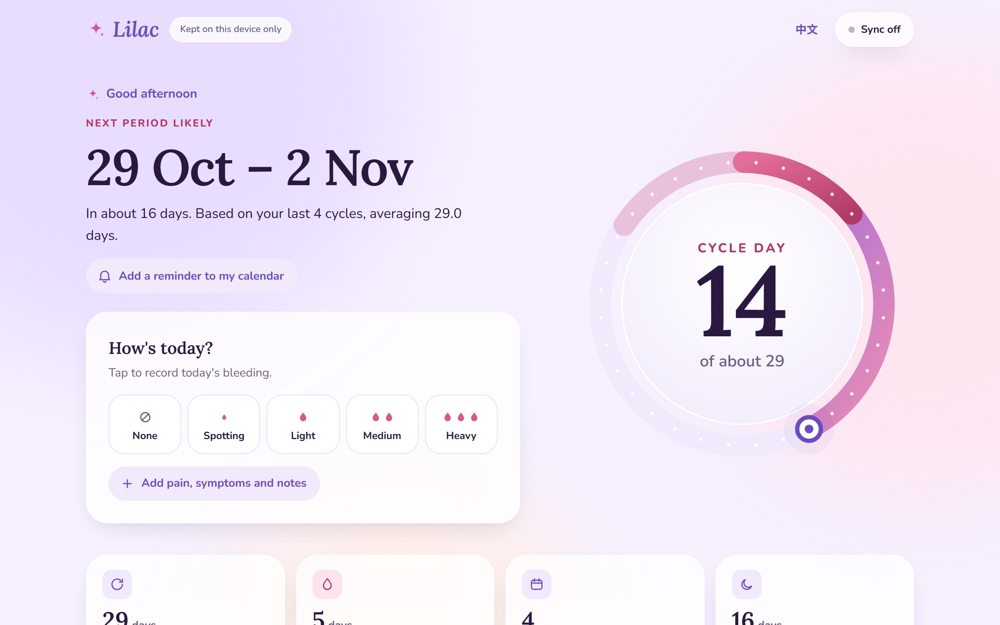

</div>

---

## Contents
- [What it does](#what-it-does)
- [Screenshots](#screenshots)
- [How it works](#how-it-works)
- [Where the health information comes from](#where-the-health-information-comes-from)
- [Run it locally](#run-it-locally)
- [Deploy (Cloudflare Pages from GitHub)](#deploy-cloudflare-pages-from-github)
- [Sync across devices (Supabase)](#sync-across-devices-supabase)
- [Project layout](#project-layout)

## What it does

| | |
|---|---|
| **One-tap check-in** | "How's today?" records today's bleeding in one tap. Pain, symptoms and notes are one more tap away. |
| **Next period estimate** | A date range built from your own recent cycles, never a single over-confident date. |
| **Cycle dial** | A ring that fills through the cycle: rose for period days, a soft band where the next period is expected, a pearl for today. |
| **Guidance with sources** | Tips for where you are in your cycle, plus flags for things the NHS says are worth checking with a doctor. Every card links to its source. |
| **Calendar reminder** | Adds the next expected period to your phone's calendar, with an alert the day before. |
| **Cycle history** | Each cycle's length against the 21–35 day range the NHS describes as regular. |
| **Two languages** | English and Simplified Chinese, switchable from the header. |
| **Private by default** | Data stays in your browser. Optional sync uses your own Supabase project. |

## Screenshots

<table>
  <tr>
    <td width="33%">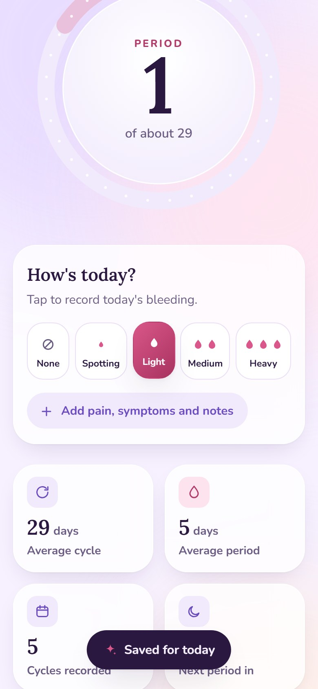</td>
    <td width="33%">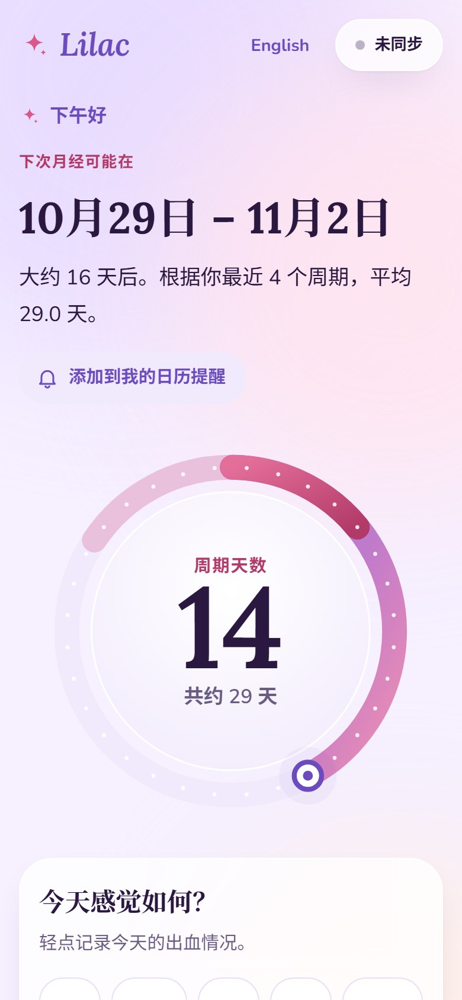</td>
    <td width="33%">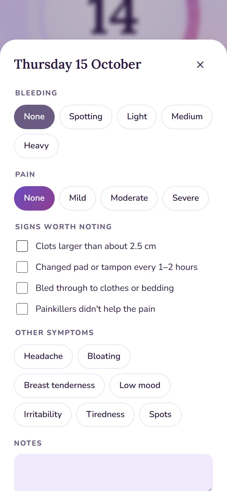</td>
  </tr>
  <tr>
    <td align="center"><sub>One-tap check-in</sub></td>
    <td align="center"><sub>简体中文</sub></td>
    <td align="center"><sub>Day details</sub></td>
  </tr>
</table>

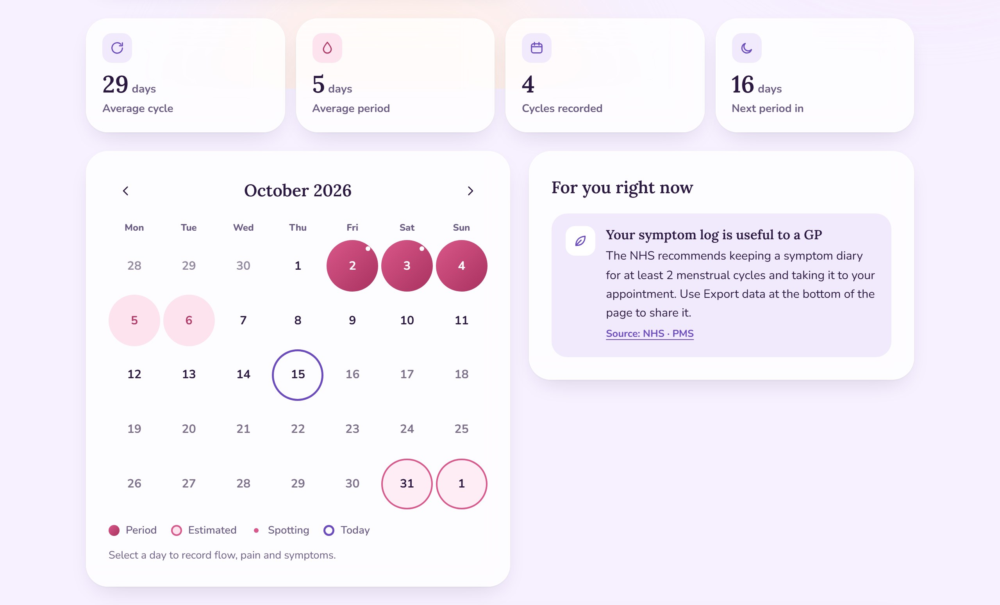

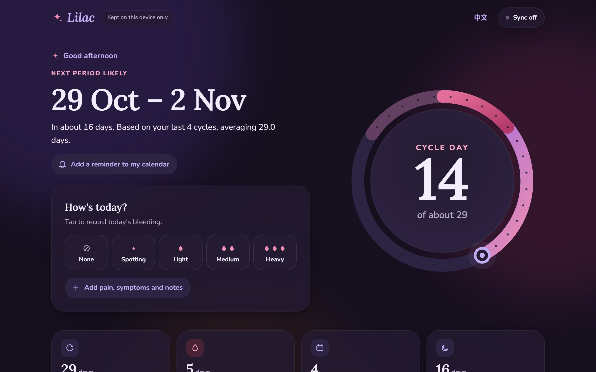

<sub>Screenshots use fictional sample data.</sub>

## How it works

### The big picture

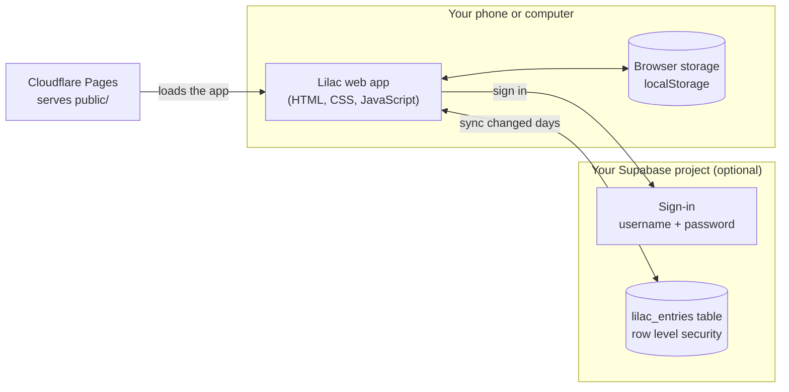

The browser copy is always the main copy, so Lilac works offline. Sync is an extra layer that keeps devices in step.

### How the next period is estimated

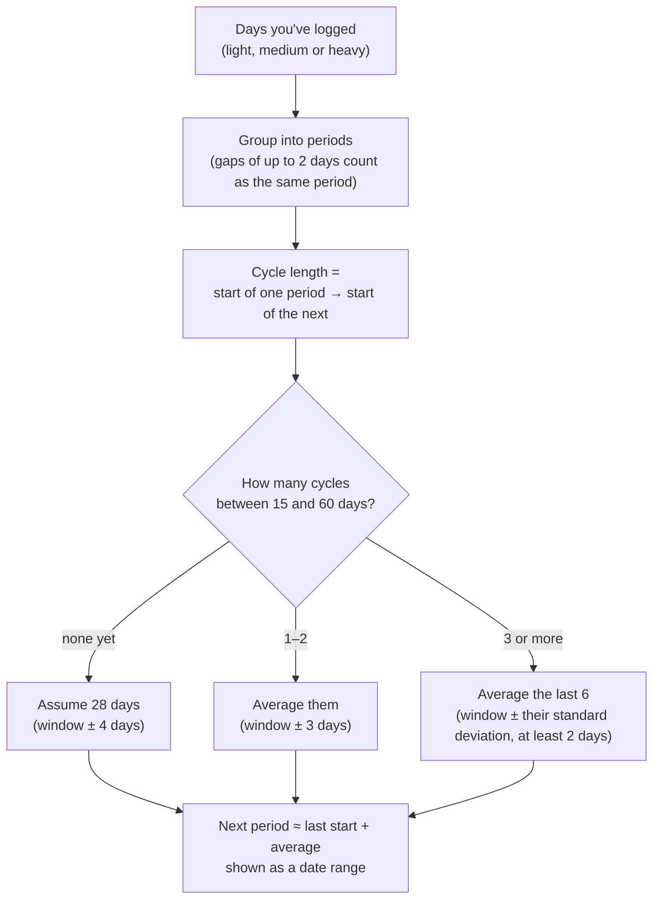

This is the calendar method. It shows a range because real cycles vary: in a study of 612,613 cycles only 13% were exactly 28 days long (Bull et al., 2019). It is not a fertility or contraception tool.

### What the dial shows

| Part of the dial | Meaning |
|---|---|
| Lilac → pink ring | Days of the cycle so far |
| Deep rose segment | This cycle's period days |
| Soft rose band | Where the next period is expected |
| Purple pearl | Today |
| Centre | Phase (Period · Pre-period · Late · Cycle day) and the day number |

### How sync keeps devices in step

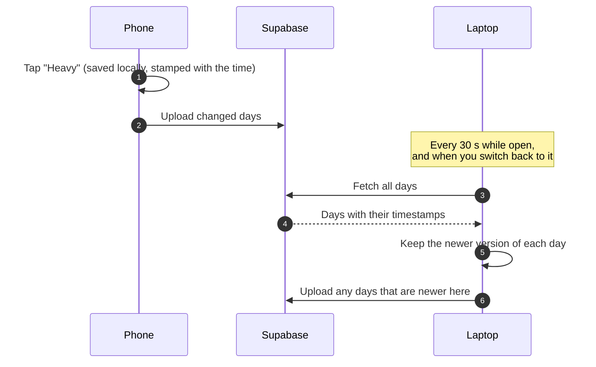

If the same day is edited on two devices, the later edit wins. Cleared days are synced too, so a deletion on one device clears it everywhere.

### Day-by-day state of the app

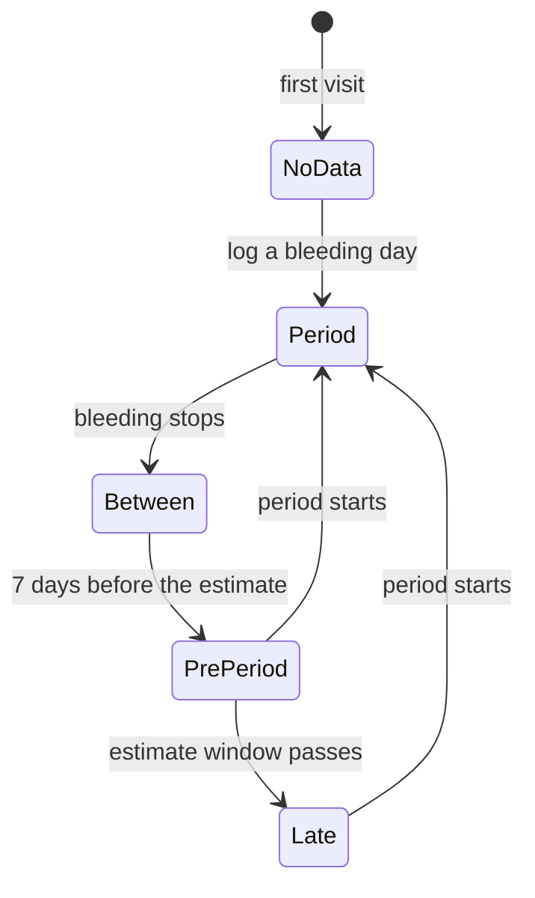

Each state picks the guidance shown: pain relief and tampon safety during a period, PMS self-care in the week before, possible causes and when to see a GP when late.

## Where the health information comes from

All guidance text is in [`public/js/i18n.js`](public/js/i18n.js) and the rules are in [`public/js/guidance.js`](public/js/guidance.js). Each message stays close to its source:

| Topic | Source |
|---|---|
| Typical cycle and bleeding length | [NHS · Periods](https://www.nhs.uk/conditions/periods/) |
| Irregular periods (gaps under 21 or over 35 days, periods over 7 days) | [NHS · Irregular periods](https://www.nhs.uk/conditions/irregular-periods/) |
| Signs of heavy bleeding | [NHS · Heavy periods](https://www.nhs.uk/conditions/heavy-periods/) |
| Easing pain, when it's urgent | [NHS · Period pain](https://www.nhs.uk/conditions/period-pain/) |
| PMS self-care, symptom diary | [NHS · PMS](https://www.nhs.uk/conditions/pre-menstrual-syndrome/) |
| Late or missed periods | [NHS · Stopped or missed periods](https://www.nhs.uk/conditions/stopped-or-missed-periods/) |
| Tampon safety | [NHS · Toxic shock syndrome](https://www.nhs.uk/conditions/toxic-shock-syndrome/) |
| Real-world cycle variation | [Bull et al., *npj Digital Medicine* 2019](https://doi.org/10.1038/s41746-019-0152-7) |

Lilac gives general information. It can't diagnose anything and must not be used as contraception.

## Run it locally

No build step. Serve the `public` folder:

```bash
python -m http.server 5178 --directory public
```

Then open <http://localhost:5178>.

## Deploy (Cloudflare Pages from GitHub)

Every push to `main` publishes the site automatically.

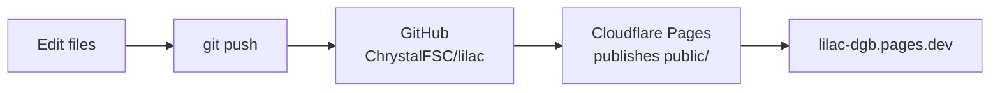

**One-time setup** in the Cloudflare dashboard:

1. **Workers & Pages → Create → Pages → Connect to Git**, then choose this repository.
2. Build settings:

   | Setting | Value |
   |---|---|
   | Production branch | `main` |
   | Framework preset | None |
   | Build command | *(leave empty)* |
   | Build output directory | `public` |

3. **Save and Deploy.**

[`public/_headers`](public/_headers) adds security headers: a content security policy allowing only the app's own files, jsDelivr, Google Fonts and Supabase, and no embedding in other sites.

> When you change CSS or JS, bump the `?v=` number on the links in `public/index.html` so phones fetch the new files instead of a cached copy.

## Sync across devices (Supabase)

Optional. Without it, data stays in the browser you use.

1. Create a free project at <https://supabase.com> (Singapore region for Malaysia).
2. **SQL Editor → New query**: paste [`supabase/setup.sql`](supabase/setup.sql) and **Run**.
3. **Authentication → Sign In / Providers → Email**: turn **off "Confirm email"**.
4. **Authentication → URL Configuration**: set the **Site URL** to your live address.
5. **Project Settings → API keys**: copy the **Project URL** and **anon / publishable** key into [`public/js/config.js`](public/js/config.js). Never use the `service_role` or secret key.
6. In Lilac: **Sync off → Create an account**. On other devices, sign in with the same username and password.
7. Then turn **off "Allow new users to sign up"** so nobody else can create accounts in your project.

Usernames become `<username>@users.lilac-dgb.pages.dev` behind the scenes, and no email is ever sent. Data is protected by row level security, so each account can only read its own rows. It isn't encrypted in the database, so anyone with access to your Supabase dashboard can read it.

**Forgot the password?** In the Supabase **SQL Editor**:

```sql
update auth.users
set encrypted_password = extensions.crypt('NEW-PASSWORD-HERE', extensions.gen_salt('bf'))
where email = 'yourusername@users.lilac-dgb.pages.dev';
```

Free Supabase projects pause after a week without use. Restore it from the dashboard, and Lilac catches up afterwards.

## Project layout

```text
lilac/
├── public/                 ← everything Cloudflare publishes
│   ├── index.html          page structure and icons
│   ├── _headers            security headers
│   ├── css/styles.css      theme, layout, dark mode
│   └── js/
│       ├── config.js       Supabase URL and public key
│       ├── i18n.js         all text, English + 简体中文
│       ├── dates.js        date maths and formatting
│       ├── store.js        browser storage, change timestamps
│       ├── cycle.js        periods, cycles, next-period estimate
│       ├── guidance.js     guidance rules and sources
│       ├── sync.js         Supabase sign-in and merging
│       ├── ui.js           dial, check-in, calendar, history
│       └── sync-ui.js      sync button and sign-in dialog
├── supabase/
│   ├── setup.sql           table and access rules
│   └── remove-old-encrypted-tables.sql
└── docs/screenshots/       images for this README
```

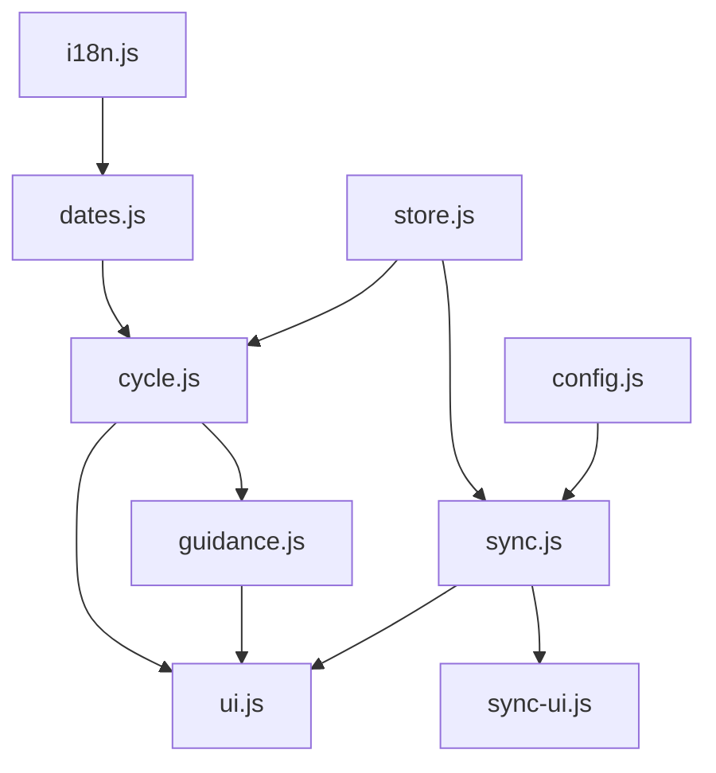
